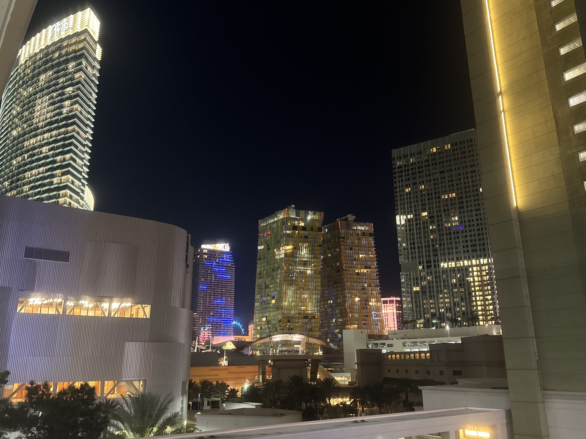

<!DOCTYPE html>
<html lang="en">
<head>
    <meta charset="UTF-8">
    <meta name="viewport" content="width=device-width, initial-scale=1.0">
    <title>Urban City Living - Responsive Design</title>
    
</head>
<body>
    

        

            <h1>Urban City Living</h1>
            
Urban city living is a dynamic dance of relentless energy, architectural grandeur, and cultural convergence. From the dizzying heights of glass-and-steel skyscrapers to the quiet, hidden courtyards tucked behind historic brownstones, the metropolis pulses with a life of its own.

            
            <h2>The Vertical Rhythm</h2>
            
Life in the modern metropolis forces a shift in perspective. Space becomes a premium, teaching residents the art of minimalist efficiency. Vertical architecture transforms how we move, work, and interact, stacking coffee shops, loft apartments, and rooftop gardens into a compact, interconnected vertical grid.

            <h2>Pavement and Paradox</h2>
            
Walking the city streets reveals constant paradoxes: the roar of subway grates beneath feet sharing space with the quiet rustle of pocket parks; the blur of high-speed commuters passing slow-moving street musicians. It is an environment that tests our adaptability—and rewards it with endless discovery.

        

    

</body>
</html>
